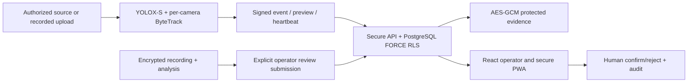

# Architecture and contract map

The secure backend is authoritative. Offline promotion is an authenticated human action, not an unsigned replacement for HMAC machine ingestion. Queue acceptance is not incident confirmation. Recorded capture time is unverified; detected_at is submission time and source_pts_ms carries media position.

Migrations: 0001–0015 → rsint_cam1 → rsint_case1 → rsint_run1 → rsint_case2 → 0020 → 0021 → 0022. 0021 adds two offline tenant indexes;0022 gives six identifier-only functions a column-limited NOLOGIN owner. Existing integration DB upgraded only after verified backup/restore rehearsal. Runtime/migrator remain NOBYPASSRLS.

## Registered router declarations (source inspection)
Method/path | Function/source | Authentication evidence
---|---|---
GET /api/alerts | `backend/app/api/alerts.py:74` `list_alerts` | session + declared permission
GET /api/alerts/{alert_id} | `backend/app/api/alerts.py:98` `get_alert` | session + declared permission
POST /api/alerts | `backend/app/api/alerts.py:108` `create_alert` | session + declared permission
POST /api/alerts/{alert_id}/confirm | `backend/app/api/alerts.py:163` `confirm` | session + declared permission
POST /api/alerts/{alert_id}/reject | `backend/app/api/alerts.py:172` `reject` | session + declared permission
POST /api/alerts/{alert_id}/assign | `backend/app/api/alerts.py:181` `assign` | session + declared permission
GET /api/audit/chain | `backend/app/api/audit.py:17` `list_entries` | session + declared permission
GET /api/audit/verify | `backend/app/api/audit.py:32` `verify` | session + declared permission
GET /api/auth/csrf | `backend/app/api/auth.py:77` `csrf` | inspect source (auth dependency may be indirect/public)
POST /api/auth/login | `backend/app/api/auth.py:84` `login` | inspect source (auth dependency may be indirect/public)
POST /api/auth/mfa/verify | `backend/app/api/auth.py:97` `mfa_verify` | inspect source (auth dependency may be indirect/public)
POST /api/auth/mfa/enroll/start | `backend/app/api/auth.py:108` `enroll_start` | inspect source (auth dependency may be indirect/public)
POST /api/auth/mfa/enroll/confirm | `backend/app/api/auth.py:119` `enroll_confirm` | inspect source (auth dependency may be indirect/public)
POST /api/auth/refresh | `backend/app/api/auth.py:129` `refresh` | inspect source (auth dependency may be indirect/public)
POST /api/auth/logout | `backend/app/api/auth.py:149` `logout` | session + declared permission
POST /api/auth/reauth | `backend/app/api/auth.py:157` `reauth` | session + declared permission
GET /api/auth/me | `backend/app/api/auth.py:168` `me` | session + declared permission
POST /api/auth/invitations/inspect | `backend/app/api/auth.py:186` `inspect_invitation` | inspect source (auth dependency may be indirect/public)
POST /api/auth/invitations/accept | `backend/app/api/auth.py:196` `accept_invitation` | inspect source (auth dependency may be indirect/public)
POST /api/auth/reset/inspect | `backend/app/api/auth.py:206` `inspect_reset` | inspect source (auth dependency may be indirect/public)
POST /api/auth/reset/accept | `backend/app/api/auth.py:212` `accept_reset` | inspect source (auth dependency may be indirect/public)
POST /api/auth/password | `backend/app/api/auth.py:220` `change_password` | session + declared permission
GET /api/camera-control/cameras | `backend/app/api/camera_control.py:136` `list_cameras` | session + declared permission
GET /api/camera-control/cameras/{camera_id} | `backend/app/api/camera_control.py:142` `get_camera` | session + declared permission
GET /api/camera-control/cameras/{camera_id}/versions | `backend/app/api/camera_control.py:147` `list_versions` | session + declared permission
GET /api/camera-control/cameras/{camera_id}/versions/{version_id} | `backend/app/api/camera_control.py:159` `get_version` | session + declared permission
GET /api/camera-control/cameras/{camera_id}/versions/{version_id}/diff | `backend/app/api/camera_control.py:166` `diff_version` | session + declared permission
GET /api/camera-control/cameras/{camera_id}/grants | `backend/app/api/camera_control.py:190` `list_grants` | session + declared permission
GET /api/camera-control/cameras/{camera_id}/eligibility | `backend/app/api/camera_control.py:195` `eligibility` | session + declared permission
GET /api/camera-control/cameras/{camera_id}/health | `backend/app/api/camera_control.py:209` `health_history` | session + declared permission
PATCH /api/camera-control/cameras/{camera_id} | `backend/app/api/camera_control.py:229` `update_camera` | session + declared permission
POST /api/camera-control/cameras/{camera_id}/lifecycle | `backend/app/api/camera_control.py:264` `change_lifecycle` | session + declared permission
POST /api/camera-control/cameras/{camera_id}/source | `backend/app/api/camera_control.py:286` `set_source` | session + declared permission
POST /api/camera-control/cameras/{camera_id}/pause | `backend/app/api/camera_control.py:334` `pause` | session + declared permission
POST /api/camera-control/cameras/{camera_id}/resume | `backend/app/api/camera_control.py:341` `resume` | session + declared permission
POST /api/camera-control/cameras/{camera_id}/disable | `backend/app/api/camera_control.py:348` `disable` | session + declared permission
POST /api/camera-control/cameras/{camera_id}/enable-request | `backend/app/api/camera_control.py:355` `enable_request` | session + declared permission
POST /api/camera-control/cameras/{camera_id}/enable | `backend/app/api/camera_control.py:364` `enable` | session + declared permission
POST /api/camera-control/cameras/{camera_id}/grants | `backend/app/api/camera_control.py:375` `create_grant` | session + declared permission
POST /api/camera-control/cameras/{camera_id}/grants/{grant_id}/revoke | `backend/app/api/camera_control.py:409` `revoke_grant` | session + declared permission
POST /api/camera-control/cameras/{camera_id}/config/validate | `backend/app/api/camera_control.py:435` `validate_config` | session + declared permission
POST /api/camera-control/cameras/{camera_id}/versions | `backend/app/api/camera_control.py:450` `create_version` | session + declared permission
POST /api/camera-control/cameras/{camera_id}/versions/{version_id}/validate | `backend/app/api/camera_control.py:525` `validate_version` | session + declared permission
POST /api/camera-control/cameras/{camera_id}/versions/{version_id}/submit | `backend/app/api/camera_control.py:534` `submit_version` | session + declared permission
POST /api/camera-control/cameras/{camera_id}/versions/{version_id}/approve | `backend/app/api/camera_control.py:548` `approve_version` | session + declared permission
POST /api/camera-control/cameras/{camera_id}/versions/{version_id}/reject | `backend/app/api/camera_control.py:557` `reject_version` | session + declared permission
POST /api/camera-control/cameras/{camera_id}/activate | `backend/app/api/camera_control.py:614` `activate` | session + declared permission
POST /api/camera-control/cameras/{camera_id}/rollback | `backend/app/api/camera_control.py:621` `rollback` | session + declared permission
GET /api/ingest/cameras/{camera_id}/config | `backend/app/api/camera_worker.py:31` `desired_config` | HMAC service principal
POST /api/ingest/cameras/{camera_id}/config/ack | `backend/app/api/camera_worker.py:39` `ack_config` | HMAC service principal
GET /api/cameras/discovery | `backend/app/api/cameras.py:25` `get_camera_discovery` | session + declared permission
POST /api/cameras/provision/ilisesti-dn17 | `backend/app/api/cameras.py:48` `provision_ilisesti_camera` | session + declared permission
GET /api/cameras/{camera_id}/worker | `backend/app/api/cameras.py:100` `get_camera_worker` | session + declared permission
POST /api/cameras/{camera_id}/worker/start | `backend/app/api/cameras.py:110` `start_camera_worker` | session + declared permission
POST /api/cameras/{camera_id}/worker/stop | `backend/app/api/cameras.py:139` `stop_camera_worker` | session + declared permission
POST /api/cameras/{camera_id}/worker/restart | `backend/app/api/cameras.py:160` `restart_camera_worker` | session + declared permission
GET /api/cameras/{camera_id} | `backend/app/api/cameras.py:189` `get_camera` | session + declared permission
GET /api/cameras/{camera_id}/preview | `backend/app/api/cameras.py:199` `get_live_preview` | session + declared permission
POST /api/cameras | `backend/app/api/cameras.py:221` `create_camera` | session + declared permission
PATCH /api/cameras/{camera_id} | `backend/app/api/cameras.py:237` `update_camera` | session + declared permission
GET /api/events/{number}/related | `backend/app/api/casework.py:60` `related` | session + declared permission
POST /api/events/{number}/links | `backend/app/api/casework.py:70` `add_link` | session + declared permission
DELETE /api/events/{number}/links/{link_id} | `backend/app/api/casework.py:93` `remove_link` | session + declared permission
GET /api/events/{number}/followups | `backend/app/api/casework.py:125` `list_followups` | session + declared permission
GET /api/events/{number}/followup-assignees | `backend/app/api/casework.py:133` `followup_assignees` | session + declared permission
POST /api/events/{number}/followups | `backend/app/api/casework.py:150` `create_followup` | session + declared permission
PATCH /api/events/{number}/followups/{followup_id} | `backend/app/api/casework.py:173` `update_followup` | session + declared permission
GET /api/events/{number}/legal-hold | `backend/app/api/casework.py:210` `legal_hold` | session + declared permission
POST /api/events/{number}/legal-hold | `backend/app/api/casework.py:218` `place_legal_hold` | session + declared permission
POST /api/events/{number}/legal-hold/release | `backend/app/api/casework.py:238` `release_legal_hold` | session + declared permission
GET /api/archive/assignees | `backend/app/api/casework.py:266` `archive_assignees` | session + declared permission
POST /api/exports/verify | `backend/app/api/casework.py:351` `verify_uploaded_package` | session + declared permission
GET /api/audit/evidence | `backend/app/api/casework.py:426` `evidence_integrity` | session + declared permission
POST /api/login | `backend/app/api/contract.py:65` `login` | inspect source (auth dependency may be indirect/public)
POST /api/logout | `backend/app/api/contract.py:92` `logout` | session + declared permission
GET /api/me | `backend/app/api/contract.py:102` `me` | session + declared permission
GET /api/meta | `backend/app/api/contract.py:107` `meta` | session + declared permission
GET /api/events | `backend/app/api/contract.py:134` `events` | session + declared permission
GET /api/events/{number} | `backend/app/api/contract.py:149` `event` | session + declared permission
POST /api/events/{number}/view | `backend/app/api/contract.py:157` `viewed` | session + declared permission
POST /api/events/{number}/decision | `backend/app/api/contract.py:169` `decide` | session + declared permission
GET /api/cameras | `backend/app/api/contract.py:213` `cameras` | session + declared permission
GET /api/stats | `backend/app/api/contract.py:236` `stats` | session + declared permission
POST /api/search | `backend/app/api/contract.py:319` `search_post` | session + declared permission
GET /api/search | `backend/app/api/contract.py:335` `search_get` | session + declared permission
GET /api/saved-searches | `backend/app/api/contract.py:359` `saved_searches` | session + declared permission
POST /api/saved-searches | `backend/app/api/contract.py:372` `create_saved_search` | session + declared permission
PUT /api/saved-searches/{search_id} | `backend/app/api/contract.py:407` `update_saved_search` | session + declared permission
DELETE /api/saved-searches/{search_id} | `backend/app/api/contract.py:437` `delete_saved_search` | session + declared permission
POST /api/saved-searches/{search_id}/run | `backend/app/api/contract.py:460` `run_saved_search` | session + declared permission
GET /api/audit | `backend/app/api/contract.py:487` `audit` | session + declared permission
GET /api/media/{evidence_id} | `backend/app/api/contract.py:502` `media` | session + declared permission
GET /api/stream | `backend/app/api/contract.py:613` `stream` | session + declared permission
GET /api/evidence | `backend/app/api/evidence.py:62` `list_for_alert` | session + declared permission
GET /api/evidence/{evidence_id} | `backend/app/api/evidence.py:112` `get_evidence` | session + declared permission
POST /api/evidence/{evidence_id}/access | `backend/app/api/evidence.py:128` `request_access` | session + declared permission
POST /api/evidence/{evidence_id}/export | `backend/app/api/evidence.py:158` `export` | session + declared permission
GET /api/evidence/{evidence_id}/content | `backend/app/api/evidence.py:186` `content` | session + declared permission
GET /api/health/live | `backend/app/api/health.py:44` `live` | inspect source (auth dependency may be indirect/public)
GET /api/health/ready | `backend/app/api/health.py:75` `ready` | inspect source (auth dependency may be indirect/public)
GET /api/metrics/detailed | `backend/app/api/health.py:86` `metrics_text` | inspect source (auth dependency may be indirect/public)
GET /api/ops/reliability | `backend/app/api/health.py:101` `ops_status` | session + declared permission
POST /api/ingest/ping | `backend/app/api/ingest.py:57` `ping` | HMAC service principal
POST /api/ingest/events | `backend/app/api/ingest.py:121` `ingest_event` | HMAC service principal
POST /api/ingest/cameras/{camera_id}/heartbeat | `backend/app/api/ingest.py:339` `ingest_heartbeat` | HMAC service principal
POST /api/ingest/cameras/{camera_id}/preview | `backend/app/api/ingest.py:378` `ingest_camera_preview` | HMAC service principal
PUT /api/ingest/cameras/{camera_id}/video | `backend/app/api/ingest.py:427` `ingest_camera_video` | HMAC service principal
DELETE /api/ingest/cameras/{camera_id} | `backend/app/api/ingest.py:463` `reset_camera` | HMAC service principal
GET /api/events/{number}/case | `backend/app/api/investigation.py:92` `case_dossier` | session + declared permission
GET /api/events/{number}/notes | `backend/app/api/investigation.py:119` `list_notes` | session + declared permission
POST /api/events/{number}/notes | `backend/app/api/investigation.py:129` `create_note` | session + declared permission
GET /api/events/{number}/notes/{note_id}/revisions | `backend/app/api/investigation.py:160` `note_revisions` | session + declared permission
POST /api/events/{number}/notes/{note_id}/revisions | `backend/app/api/investigation.py:170` `revise_note` | session + declared permission
POST /api/events/{number}/notes/{note_id}/retract | `backend/app/api/investigation.py:197` `retract_note` | session + declared permission
GET /api/events/{number}/bookmarks | `backend/app/api/investigation.py:224` `list_bookmarks` | session + declared permission
POST /api/events/{number}/bookmarks | `backend/app/api/investigation.py:232` `create_bookmark` | session + declared permission
DELETE /api/events/{number}/bookmarks/{bookmark_id} | `backend/app/api/investigation.py:257` `delete_bookmark` | session + declared permission
POST /api/archive/search | `backend/app/api/investigation.py:283` `archive_search` | session + declared permission
GET /api/archive/saved | `backend/app/api/investigation.py:361` `saved_searches` | session + declared permission
POST /api/archive/saved | `backend/app/api/investigation.py:377` `save_search` | session + declared permission
DELETE /api/archive/saved/{search_id} | `backend/app/api/investigation.py:400` `delete_saved_search` | session + declared permission
GET /api/events/{number}/exports | `backend/app/api/investigation.py:482` `list_exports` | session + declared permission
POST /api/events/{number}/exports | `backend/app/api/investigation.py:496` `request_export` | session + declared permission
GET /api/exports/{export_id} | `backend/app/api/investigation.py:537` `get_export` | session + declared permission
POST /api/exports/{export_id}/run | `backend/app/api/investigation.py:544` `run_export` | session + declared permission
POST /api/exports/{export_id}/cancel | `backend/app/api/investigation.py:557` `cancel_export` | session + declared permission
POST /api/exports/{export_id}/link | `backend/app/api/investigation.py:584` `export_link` | session + declared permission
GET /api/exports/{export_id}/download | `backend/app/api/investigation.py:620` `download_export` | session + declared permission
GET /api/recordings/{recording_id}/analyses/{run_id}/analytics/summary | `backend/app/api/offline_analytics.py:203` `analytics_summary` | session + declared permission
GET /api/recordings/{recording_id}/analyses/{run_id}/analytics/heatmap | `backend/app/api/offline_analytics.py:274` `analytics_heatmap` | session + declared permission
GET /api/recordings/{recording_id}/analyses/{run_id}/analytics/timeline | `backend/app/api/offline_analytics.py:313` `analytics_timeline` | session + declared permission
GET /api/recordings/{recording_id}/analyses/{run_id}/analytics/frame | `backend/app/api/offline_analytics.py:342` `analytics_reference_frame` | session + declared permission
GET /api/recordings/{recording_id}/analyses/{run_id}/candidates | `backend/app/api/offline_analytics.py:404` `offline_candidates` | session + declared permission
POST /api/recordings/{recording_id}/analyses/{run_id}/candidates/{index}/promote | `backend/app/api/offline_analytics.py:466` `promote_candidate` | session + declared permission
POST /api/recordings | `backend/app/api/offline_video.py:155` `import_recording` | session + declared permission
GET /api/recordings | `backend/app/api/offline_video.py:263` `list_recordings` | session + declared permission
GET /api/recordings/{recording_id} | `backend/app/api/offline_video.py:283` `get_recording` | session + declared permission
GET /api/recordings/{recording_id}/thumbnail | `backend/app/api/offline_video.py:308` `recording_thumbnail` | session + declared permission
PATCH /api/recordings/{recording_id}/crop | `backend/app/api/offline_video.py:339` `save_crop` | session + declared permission
POST /api/recordings/{recording_id}/analyses | `backend/app/api/offline_video.py:378` `create_analysis` | session + declared permission
GET /api/analyses/{run_id} | `backend/app/api/offline_video.py:487` `get_analysis` | session + declared permission
GET /api/recordings/{recording_id}/analyses | `backend/app/api/offline_video.py:497` `list_analyses` | session + declared permission
GET /api/analyses/{run_id}/preview | `backend/app/api/offline_video.py:519` `analysis_preview` | session + declared permission
GET /api/analyses/{run_id}/video | `backend/app/api/offline_video.py:596` `analysis_video` | session + declared permission
GET /api/analyses/{run_id}/export | `backend/app/api/offline_video.py:609` `export_analysis` | session + declared permission
POST /api/analyses/{run_id}/cancel | `backend/app/api/offline_video.py:625` `cancel_analysis` | session + declared permission
GET /api/ready | `backend/app/api/ops.py:26` `ready` | inspect source (auth dependency may be indirect/public)
GET /api/metrics | `backend/app/api/ops.py:40` `prometheus` | inspect source (auth dependency may be indirect/public)
GET /api/ops/status | `backend/app/api/ops.py:72` `ops_status` | session + declared permission
GET /api/patrols | `backend/app/api/patrol.py:38` `list_patrols` | session + declared permission
POST /api/alerts/{alert_id}/patrol-status | `backend/app/api/patrol.py:66` `set_patrol_status` | session + declared permission
GET /api/push/vapid-public-key | `backend/app/api/push.py:17` `vapid_public_key` | session + declared permission
POST /api/push/subscriptions | `backend/app/api/push.py:22` `subscribe` | session + declared permission
DELETE /api/push/subscriptions | `backend/app/api/push.py:41` `unsubscribe_all` | session + declared permission
GET /api/retention | `backend/app/api/retention.py:60` `get_policy` | session + declared permission
PUT /api/retention | `backend/app/api/retention.py:71` `put_policy` | session + declared permission
POST /api/retention/purge | `backend/app/api/retention.py:94` `purge` | session + declared permission
POST /api/retention/holds/{alert_id} | `backend/app/api/retention.py:114` `set_hold` | session + declared permission
DELETE /api/retention/holds/{alert_id} | `backend/app/api/retention.py:131` `release_hold` | session + declared permission
GET /api/service-accounts | `backend/app/api/service_accounts.py:80` `list_accounts` | session + declared permission
POST /api/service-accounts | `backend/app/api/service_accounts.py:88` `create_account` | session + declared permission
PATCH /api/service-accounts/{account_id} | `backend/app/api/service_accounts.py:116` `update_account` | session + declared permission
POST /api/service-accounts/{account_id}/keys | `backend/app/api/service_accounts.py:135` `issue_key` | session + declared permission
DELETE /api/service-accounts/{account_id}/keys/{key_id} | `backend/app/api/service_accounts.py:157` `revoke_key` | session + declared permission
GET /api/sessions | `backend/app/api/sessions.py:34` `list_my_sessions` | session + declared permission
DELETE /api/sessions/{session_id} | `backend/app/api/sessions.py:45` `revoke_my_session` | session + declared permission
POST /api/sessions/revoke-others | `backend/app/api/sessions.py:53` `revoke_other_sessions` | session + declared permission
GET /api/stats/response | `backend/app/api/stats_response.py:64` `response_stats` | session + declared permission
GET /api/tenants/current | `backend/app/api/tenants.py:29` `current_tenant` | session + declared permission
POST /api/tenants | `backend/app/api/tenants.py:36` `create` | session + declared permission
POST /api/tenants/current/rotate-key | `backend/app/api/tenants.py:77` `rotate_key` | session + declared permission
POST /api/approvals | `backend/app/api/unblur.py:45` `create_request` | session + declared permission
GET /api/approvals | `backend/app/api/unblur.py:76` `list_requests` | session + declared permission
GET /api/approvals/{request_id} | `backend/app/api/unblur.py:88` `get_request` | session + declared permission
POST /api/approvals/{request_id}/approve | `backend/app/api/unblur.py:95` `approve` | session + declared permission
POST /api/approvals/{request_id}/deny | `backend/app/api/unblur.py:127` `deny` | session + declared permission
POST /api/approvals/{request_id}/revoke | `backend/app/api/unblur.py:146` `revoke` | session + declared permission
GET /api/users | `backend/app/api/users.py:47` `list_users` | session + declared permission
PATCH /api/users/{user_id} | `backend/app/api/users.py:52` `update_user` | session + declared permission
GET /api/users/invitations | `backend/app/api/users.py:81` `list_invitations` | session + declared permission
POST /api/users/invitations | `backend/app/api/users.py:90` `create_invitation` | session + declared permission
DELETE /api/users/invitations/{invitation_id} | `backend/app/api/users.py:115` `revoke_invitation` | session + declared permission
GET /api/users/{user_id}/sessions | `backend/app/api/users.py:129` `list_user_sessions` | session + declared permission
DELETE /api/users/{user_id}/sessions/{session_id} | `backend/app/api/users.py:142` `revoke_user_session` | session + declared permission
POST /api/users/{user_id}/reset-requests | `backend/app/api/users.py:156` `request_account_reset` | session + declared permission
POST /api/users/reset-requests/{approval_id}/issue | `backend/app/api/users.py:186` `issue_reset_token` | session + declared permission
POST /api/users/{user_id}/sessions/revoke-all | `backend/app/api/users.py:221` `revoke_all_user_sessions` | session + declared permission

## Key new contract
POST /api/recordings/{recording_id}/analyses/{run_id}/candidates/{index}/promote: session, CSRF, alerts:create AND videos:analyze; completed tenant-owned run and authenticated output required. Body reason (10–500 chars), optional synthetic_test flag. Returns numeric canonical event id, origin=recorded_upload and duplicate flag. 403 unauthorized; 404 tenant/job/candidate hidden; 409 output/PTS unavailable; 422 analytics-only candidate or invalid fields; 503 encoder unavailable. Alert remains new until existing decision route acts. Advisory lock per tenant/recording serializes retries; event_key=offline:<run>:<index>.
Managed heartbeat adds worker_epoch, seq and optional telemetry (validated old Heartbeat shape). Reply carries lease/directive/desired revision. Legacy telemetry body retains 204 behavior. Managed preview/event requires current unexpired epoch and acknowledged active revision.
Camera desired config now includes source_fingerprint, never the source URL. Local worker maps replay reference to an explicit loopback-only source; config revision change exits current tracker process for Supervisor restart. No tracker identity is shared between cameras.